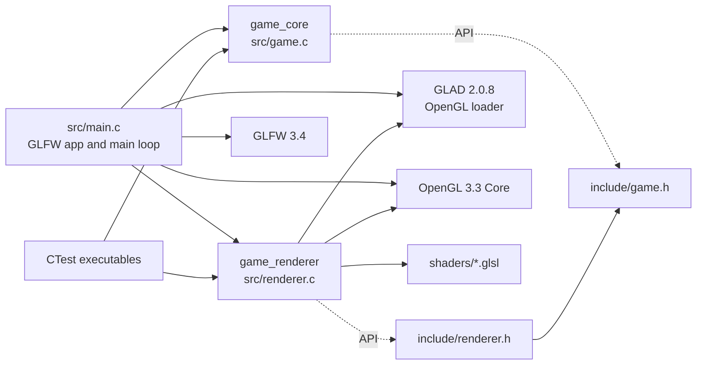
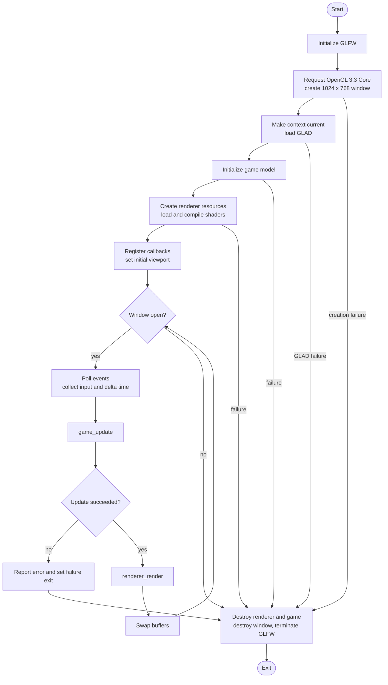

# Architecture

## System overview

Space Invaders is a C17 desktop application. Its runtime is split into three cooperating parts:

- **Application and platform integration (`src/main.c`)** owns GLFW initialization, the window and OpenGL context, keyboard and framebuffer callbacks, the event loop, and ordered shutdown.
- **Game simulation (`src/game.c`)** owns session state and updates player, enemies, projectiles, collisions, score, lives, and wave progression. It does not depend on GLFW or OpenGL.
- **Rendering (`src/renderer.c`)** consumes game state and renders the 2D scene with OpenGL 3.3. It also exposes renderer helpers for viewport calculation and state-specific display text.

The public interfaces are declared in [`include/game.h`](include/game.h) and [`include/renderer.h`](include/renderer.h). CMake builds the simulation and renderer as static libraries and links them into the `space_invaders` executable.

## Module and dependency diagram

GLFW and GLAD are fetched by CMake from their pinned Git tags. GLAD's CMake integration generates the OpenGL 3.3 Core loader. The renderer compiles the vertex and fragment shaders at runtime from the `shaders/` directory relative to the process working directory.

## Runtime flow

`main` initializes GLFW, requests a 3.3 Core context, creates the window, loads OpenGL entry points with GLAD, initializes the game, and then initializes renderer objects. On startup or update failure, it prints a diagnostic and follows the shared cleanup path. Renderer resources are released while the window's OpenGL context still exists; then the window is destroyed and GLFW is terminated.

During each frame, `glfwPollEvents` runs first. A key callback records one-shot SPACE, ESC, and ENTER events on key press; A/D and arrow-key movement is polled as a held state. The loop computes elapsed time, calls `game_update`, clears the one-shot input flags, renders the current state at the current framebuffer size, and swaps buffers. `glfwSwapInterval(1)` requests vertical synchronization.

## Game model and algorithms

### State and input

`Game` tracks the menu, playing, paused, Game Over, and victory states. ENTER starts a session from the menu, resumes from pause, and starts a fresh game after Game Over. ESC pauses active gameplay. Victory and Game Over do not advance simulation state. The application maps GLFW events to `GameInput` and calls the simulation through `game_update`.

The fixed logical playfield is 1024 x 768. The player moves horizontally at a fixed units-per-second speed and is clamped to the playfield edges. Opposing left/right inputs cancel each other. `game_update` rejects null arguments, non-finite elapsed time, and negative elapsed time; positive frame deltas are capped at 0.25 seconds to limit large simulation steps after stalls. A zero delta can still create a requested projectile, but skips movement and collision processing for that update.

### Waves, enemies, and projectiles

Each wave contains four rows of enemies. Wave one starts with eight columns; the number of columns increases from wave four and is capped at 18. Wave-two and wave-three speeds each increase by 15 percent relative to the previous wave. Starting at wave four, speed grows by a further factor of 1.10 per wave. The campaign's final wave is configured at CMake time and defaults to five.

Enemy formations move horizontally using the greatest speed among active enemies. When the formation would cross a horizontal edge, it is clamped at that edge, reverses direction, and descends by its configured drop distance in addition to the continuous downward drift. Player projectiles move upward. Axis-aligned rectangle overlap checks resolve projectile/enemy hits and enemy/player contact. A projectile hit removes both entities and adds the enemy's configured points; an invader reaching the player's lower region or hitting the ship is removed and costs one life.

Inactive entities are compacted in-place after collision processing. Enemies and projectiles are stored in separate dynamically grown arrays. Capacity starts at 32 entries and doubles when needed; allocation size overflow and `realloc` failure are checked. The game has no fixed projectile count limit. `game_destroy` frees both arrays.

### Rendering and layout

The renderer converts the 1024 x 768 logical coordinates into OpenGL clip coordinates and computes a centered 4:3 viewport, leaving letterbox/pillarbox margins when the framebuffer has a different aspect ratio. The player ship is a 16 x 20 embedded pixel-art map with a four-world-unit pixel size, drawn as horizontal runs of black, white, red, and blue rectangles. Its 64 x 80 world-unit logical bounds match the sprite dimensions. Other shapes use a dynamic vertex buffer and shader program; the background contains 40 fixed stars. UI text uses a small embedded bitmap glyph table rather than an external font library. `renderer_format_text` prepares strings and visibility flags for the menu, HUD, pause, Game Over, and victory screens.

The application requests an initial 1024 x 768 window and sets a minimum size of 800 x 600. The framebuffer callback sets a viewport directly; the renderer then calculates and applies the logical 4:3 viewport during drawing.

## Resource ownership and error handling

| Resource | Owner | Creation and release |
| --- | --- | --- |
| GLFW library and window | `main` | Initialized before window creation; window destroyed before `glfwTerminate`. |
| OpenGL context | GLFW window, managed by `main` | Made current before GLAD, game renderer, or renderer teardown uses OpenGL. |
| Enemy and projectile arrays | `Game` | Grown with `realloc`; released and zeroed by `game_destroy`. |
| Shader source and compiler/linker logs | Renderer helper functions | Loaded/allocated temporarily and freed after use; shader/program failures are reported to standard error. |
| Shader program, VAO, VBO | `Renderer` | Created by `renderer_init`; conditionally deleted by `renderer_destroy`, which requires a current valid OpenGL context when handles are nonzero. |

`main` starts with a failure exit status and changes it to success after successful initialization. GLFW errors are reported through its error callback. Failure to initialize GLFW, create a window, load GLAD, initialize the game or renderer, or update the game results in a diagnostic and nonzero exit. `game_update` reports allocation/update failures with `false`; the application does not silently continue after such a failure.

## Security and robustness considerations

This section records implementation characteristics; it is not a security audit.

- Runtime input is limited to GLFW key events and held-key polling; the game does not parse user-provided text or network data.
- Shader files are read from relative paths in the current working directory. Running from a directory containing a different `shaders/` tree changes which shader source is loaded; only run trusted builds and shader assets.
- Dynamic entity allocation checks capacity overflow and allocation failure. Other public struct fields are caller-owned, and the C API does not validate every possible externally constructed entity or game-state invariant.
- The renderer depends on a valid OpenGL context for graphics calls and resource deletion. Callers must follow the initialization and teardown order described above.
- CMake downloads build dependencies from upstream repositories during configuration; this is a build-time network and dependency-trust boundary, not a runtime network feature.

## Build and verification references

See [`README.md`](README.md) for platform prerequisites and build commands, [`API_REFERENCE.md`](API_REFERENCE.md) for the public C contracts, and [`TESTING.md`](TESTING.md) for automated test coverage and its limits.
