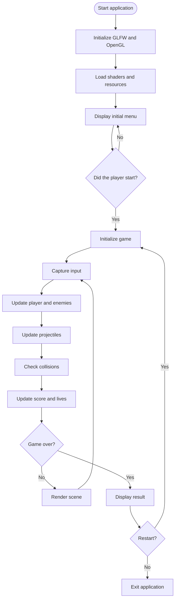

# Software Specification -- Space Invaders

**Version:** 1.0  
**System type:** 2D electronic game  
**Project name:** Space Invaders  
**Platform:** Desktop (Windows/Linux)  
**Programming language:** C  
**Graphics library:** OpenGL

------------------------------------------------------------------------

# 1. Introduction

## 1.1 Objective

This document presents the functional and technical specification for
developing a game inspired by the classic *Space Invaders*, using the C
programming language and the OpenGL graphics library.

The objective of the game is to control a spaceship that must eliminate
waves of alien invaders before they reach the bottom of the screen.

The player must move the ship horizontally, fire projectiles at the
enemies, accumulate points, and survive as many waves of invaders as
possible.

## 1.2 Project scope

The system must implement the following features:

- Display an initial screen.
- Control the player's ship movement.
- Fire projectiles.
- Generate and move enemies.
- Detect collisions.
- Maintain a scoring system.
- Maintain a lives system.
- Progressively increase difficulty.
- Provide win and loss conditions.
- Restart the game.
- Display the final score.

## 1.3 Target audience

The game is intended for users who want to play an arcade action game
with simple mechanics, intuitive controls, and progressive difficulty.

# 2. Technologies and tools

| Technology | Purpose |
| --- | --- |
| C | Main programming language |
| OpenGL | 2D graphics rendering |
| GLFW | Window and event management |
| GLAD | Loading OpenGL functions |
| CMake | Build management |
| GCC / Clang / MSVC | Code compilation |

## 2.1 Technology architecture

The system will use OpenGL to draw the game's graphical elements.

The GLFW library will be responsible for creating the window, managing
the keyboard, and controlling the event cycle.

The GLAD library will be used to load OpenGL API functions.

Using OpenGL 3.3 Core Profile with 2D rendering through shaders and
graphics primitives is recommended.

# 3. Functional requirements

Functional requirements describe the features that the system must
provide.

| ID | Requirement | Description |
| --- | --- | --- |
| RF001 | Initial screen | The system must display an initial screen with the game title. |
| RF002 | Start game | The player must be able to start a new game. |
| RF003 | Move ship | The player must be able to move the ship horizontally. |
| RF004 | Fire projectiles | The player must be able to fire projectiles at enemies. |
| RF005 | Generate enemies | The system must automatically generate a formation of enemies. |
| RF006 | Move enemies | Enemies must move horizontally and change direction when they reach the screen edges. |
| RF007 | Enemies approach | Enemies must gradually move down toward the player's ship. |
| RF008 | Detect collisions | The system must identify collisions between projectiles and enemies. |
| RF009 | Score | The system must award points when an enemy is eliminated. |
| RF010 | Lives system | The player must start with three lives. |
| RF011 | Lose a life | The player must lose a life when invaders reach the lower region of the screen or when a collision specified by the game rules occurs. |
| RF012 | Progression | The system must increase difficulty as waves are completed. |
| RF013 | Victory | The system must identify the completion of a wave or campaign, according to the game configuration. |
| RF014 | Game Over | The system must end the game when the player's lives reach zero. |
| RF015 | Restart | The player must be able to start a new game after Game Over. |
| RF016 | Pause | The player must be able to pause and resume the game. |

# 4. Non-functional requirements

| ID | Requirement | Description |
| --- | --- | --- |
| RNF001 | Language | The system must be developed in the C programming language. |
| RNF002 | Rendering | Graphics rendering must use OpenGL. |
| RNF003 | Performance | The game should target a 60 FPS refresh rate. |
| RNF004 | Resolution | The game must support a minimum resolution of 800 × 600 pixels. |
| RNF005 | Compatibility | The software must run on Windows and Linux operating systems compatible with the dependencies used. |
| RNF006 | Usability | Controls must be simple and intuitive. |
| RNF007 | Maintainability | The code must be organized into independent modules. |
| RNF008 | Portability | The project should use cross-platform libraries whenever possible. |
| RNF009 | Stability | The game must correctly handle shutdown events and graphics initialization failures. |
| RNF010 | Timing | Movement must be independent of the frame rate, using delta time. |

# 5. Business rules

Business rules define the expected behavior during a game.

| ID | Rule | Description |
| --- | --- | --- |
| RN001 | Starting lives | The player starts the game with 3 lives. |
| RN002 | Score | Each eliminated enemy awards points to the player. |
| RN003 | Basic score | A common enemy is worth 10 points. |
| RN004 | Movement | The ship must not exceed the horizontal screen boundaries. |
| RN005 | Shots | The projectile must move vertically toward the enemies. |
| RN006 | Collision | An enemy hit by a projectile must be removed from the formation. |
| RN007 | Enemy movement | When the formation reaches either edge, it must reverse direction and descend one position. |
| RN008 | New wave | When all enemies are eliminated, a new wave must begin. |
| RN009 | Difficulty | Enemy speed must increase with each new wave. |
| RN010 | Game Over | The game must end when the player loses all lives. |

## 5.1 Suggested scoring system

| Enemy type | Score |
| --- | ---: |
| Basic enemy | 10 |
| Intermediate enemy | 20 |
| Advanced enemy | 30 |
| Special ship | 100 |

## 5.2 Difficulty system

Difficulty must increase progressively.

- Wave 1: initial enemy speed.
- Wave 2: enemy speed increased by 15%.
- Wave 3: speed increased by another 15%.
- Wave 4: increase the number of enemies.
- Subsequent waves: a combination of speed and quantity.

# 6. Use cases

## 6.1 General use case diagram

**Primary actor:** Player.

**Identified use cases:**

- UC001 -- Start game.
- UC002 -- Move ship.
- UC003 -- Fire projectiles.
- UC004 -- Eliminate enemies.
- UC005 -- View score.
- UC006 -- Pause game.
- UC007 -- Resume game.
- UC008 -- End game.
- UC009 -- Restart game.

## 6.2 Detailed use case descriptions

### UC001 -- Start game

| Field | Description |
| --- | --- |
| Actor | Player |
| Objective | Start a new game. |
| Precondition | The game must be on the initial screen. |
| Postcondition | The game will start. |

**Main flow:**

1. The player opens the game.
2. The system displays the initial screen.
3. The player presses ENTER.
4. The system initializes the ship.
5. The system initializes the score to zero.
6. The system sets three lives.
7. The system generates the first enemy formation.
8. The game begins.

**Alternative flow:**

- If the player closes the window, the system must exit the application.

### UC002 -- Move ship

| Field | Description |
| --- | --- |
| Actor | Player |
| Objective | Move the ship horizontally. |
| Precondition | The game must be active. |
| Postcondition | The ship's position will be updated. |

**Main flow:**

1. The player presses the A key or the left arrow key.
2. The system identifies the command.
3. The system updates the ship's position to the left.
4. The player presses the D key or the right arrow key.
5. The system updates the ship's position to the right.
6. The system checks the screen boundaries.

**Alternative flow:**

- If the ship reaches the left edge, it must not continue moving in that
  direction.
- If the ship reaches the right edge, it must not continue moving in that
  direction.

### UC003 -- Fire projectiles

| Field | Description |
| --- | --- |
| Actor | Player |
| Objective | Fire at the invaders. |
| Precondition | The game must be active. |
| Postcondition | A projectile will be created and moved. |

**Main flow:**

1. The player presses the SPACE key.
2. The system checks whether firing is allowed.
3. The system creates a projectile at the ship's position.
4. The projectile moves vertically.
5. The system checks for collisions.
6. If the projectile passes the upper screen boundary, it will be removed.

**Alternative flow:**

- If there is a limit on simultaneous shots, the system must prevent new
  projectiles from being created until capacity is available.

### UC004 -- Eliminate enemies

| Field | Description |
| --- | --- |
| Actor | System |
| Objective | Remove enemies hit by projectiles. |
| Precondition | At least one enemy and one active projectile exist. |
| Postcondition | The enemy will be removed and the score updated. |

**Main flow:**

1. The system checks the positions of the projectiles.
2. The system checks the positions of the enemies.
3. The system identifies a collision.
4. The system removes the projectile.
5. The system removes the enemy.
6. The system awards points to the player.
7. The system updates the displayed score.

**Alternative flow:**

- If there is no collision, the projectile continues moving.

### UC005 -- View score

| Field | Description |
| --- | --- |
| Actor | Player |
| Objective | View the current score. |
| Precondition | The game must be active. |
| Postcondition | The score will be displayed in the interface. |

**Main flow:**

1. The system reads the current score.
2. The system updates the graphical component.
3. The player views the score at the top of the screen.

### UC006 -- Pause game

| Field | Description |
| --- | --- |
| Actor | Player |
| Objective | Temporarily interrupt the game. |
| Precondition | The game must be active. |
| Postcondition | The game will be paused. |

**Main flow:**

1. The player presses ESC.
2. The system changes the state to PAUSED.
3. Enemy movement is stopped.
4. Projectile movement is stopped.
5. The system displays the PAUSED message.

### UC007 -- Resume game

| Field | Description |
| --- | --- |
| Actor | Player |
| Objective | Resume a paused game. |
| Precondition | The game must be paused. |
| Postcondition | The game will resume running. |

**Main flow:**

1. The player presses ENTER.
2. The system changes the state to PLAYING.
3. The system resumes movement of the elements.
4. The game continues from where it was paused.

### UC008 -- End game

| Field | Description |
| --- | --- |
| Actor | System |
| Objective | End the game when all lives have been lost. |
| Precondition | The player must have zero lives. |
| Postcondition | The Game Over screen will be displayed. |

**Main flow:**

1. The system detects that the player's lives have reached zero.
2. The system changes the state to GAME OVER.
3. The system stops movement of the elements.
4. The system displays the final score.
5. The system makes the restart option available.

### UC009 -- Restart game

| Field | Description |
| --- | --- |
| Actor | Player |
| Objective | Start a new game. |
| Precondition | The game must be on the Game Over screen. |
| Postcondition | A new game will begin. |

**Main flow:**

1. The player presses ENTER.
2. The system clears the existing projectiles.
3. The system resets the score.
4. The system restores the three lives.
5. The system recreates the enemy formation.
6. The game begins again.

# 7. Software architecture

The software must be organized into modules to facilitate maintenance,
testing, and project evolution.

## 7.1 Module organization

| Module | Responsibility |
| --- | --- |
| GAME / MAIN | Initialization and control of the main loop |
| PLAYER | Ship and shot control |
| ENEMY | Enemy creation and movement |
| COLLISION | Collision detection and handling |
| GAME STATE | Game state control |
| RENDERER | OpenGL rendering |
| UI / HUD | Score, lives, and messages |
| OPENGL + GLFW + GLAD | Graphics layer, window, and input events |

## 7.2 Directory structure

```text
space-invaders/
│
├── CMakeLists.txt
│
├── include/
│   ├── game.h
│   ├── player.h
│   ├── enemy.h
│   ├── projectile.h
│   ├── collision.h
│   ├── renderer.h
│   └── game_state.h
│
├── src/
│   ├── main.c
│   ├── game.c
│   ├── player.c
│   ├── enemy.c
│   ├── projectile.c
│   ├── collision.c
│   ├── renderer.c
│   └── game_state.c
│
├── shaders/
│   ├── vertex.glsl
│   └── fragment.glsl
│
├── assets/
│   ├── images/
│   └── fonts/
│
└── tests/
    ├── test_player.c
    ├── test_enemy.c
    ├── test_collision.c
    └── test_game.c
```

## 7.3 Main data structures

### Player structure

```c
typedef struct {
    float x;
    float y;
    float width;
    float height;
    float speed;
    int lives;
} Player;
```

### Enemy structure

```c
typedef struct {
    float x;
    float y;
    float width;
    float height;
    float speed;
    int active;
    int points;
} Enemy;
```

### Projectile structure

```c
typedef struct {
    float x;
    float y;
    float speed;
    int active;
} Projectile;
```

### Game state

```c
typedef enum {
    MENU,
    PLAYING,
    PAUSED,
    GAME_OVER,
    VICTORY
} GameState;
```

# 8. Game execution flow

The game must use a main loop (*Game Loop*) responsible for updating the
logic and rendering the graphical elements.



## 8.1 Game Loop pseudocode

```c
while (!glfwWindowShouldClose(window)) {

    float deltaTime = calculateDeltaTime();

    processInput();

    if (gameState == PLAYING) {

        updatePlayer(deltaTime);

        updateEnemies(deltaTime);

        updateProjectiles(deltaTime);

        checkCollisions();

        updateScore();

        checkGameOver();

        checkVictory();
    }

    renderGame();

    glfwSwapBuffers(window);

    glfwPollEvents();
}
```

The `deltaTime` parameter must represent the time elapsed between two
frames, ensuring that object movement does not directly depend on FPS.

# 9. Graphics specification

## 9.1 Visual elements

The game must display the following elements:

| Element | Description |
| --- | --- |
| Player's ship | Graphical representation of the ship controlled by the player. |
| Enemies | Aliens arranged in a formation. |
| Projectiles | Graphical elements representing the shots. |
| Background | Space scene with stars. |
| HUD | Information area showing the score, lives, and current wave. |
| Menu | Interface for starting or restarting the game. |

## 9.2 Screen layout

Reference resolution: 1024 × 768 pixels.

Suggested layout:

- Top: score, lives, and current wave.
- Center region: enemy formation.
- Bottom region: player's ship.
- Background: space scene.

# 10. Test plan

Tests must validate the functional requirements, business rules, and
system stability.

## 10.1 Unit tests

Unit tests must individually validate the software modules.

| ID | Module | Scenario | Expected result |
| --- | --- | --- | --- |
| TU001 | Player | Move ship to the left. | X coordinate decreases. |
| TU002 | Player | Move ship to the right. | X coordinate increases. |
| TU003 | Player | Move beyond the left boundary. | Ship remains within the screen. |
| TU004 | Player | Move beyond the right boundary. | Ship remains within the screen. |
| TU005 | Projectile | Create projectile. | Projectile receives the correct initial position. |
| TU006 | Projectile | Update projectile position. | Y coordinate is updated according to its speed. |
| TU007 | Enemy | Create enemy. | Enemy receives its initial position and attributes. |
| TU008 | Enemy | Reach horizontal boundary. | Formation changes direction. |
| TU009 | Collision | Projectile collides with enemy. | Collision is identified. |
| TU010 | Collision | Projectile does not hit an enemy. | No collision is identified. |
| TU011 | Score | Eliminate basic enemy. | Score increases by 10 points. |
| TU012 | Game | Lose last life. | State changes to GAME_OVER. |

## 10.2 Integration tests

| ID | Scenario | Procedure | Expected result |
| --- | --- | --- | --- |
| TI001 | Player and projectile integration | Move ship and fire. | Projectile is created at the ship's position. |
| TI002 | Projectile and enemy integration | Fire at an enemy. | Enemy is eliminated. |
| TI003 | Collision and score integration | Eliminate an enemy. | Score is updated. |
| TI004 | Enemy and difficulty integration | Eliminate all enemies. | A new wave is created with greater difficulty. |
| TI005 | Lives and Game Over integration | Lose all lives. | Game Over screen is displayed. |
| TI006 | Pause and resume integration | Pause and resume the game. | The game correctly pauses and resumes. |

## 10.3 Functional tests

| ID | Feature | Expected result |
| --- | --- | --- |
| TF001 | Open application | Initial screen is displayed. |
| TF002 | Start game | First wave is displayed. |
| TF003 | Move ship | Ship moves according to the command. |
| TF004 | Fire | Projectiles are displayed on the screen. |
| TF005 | Eliminate enemies | Enemies disappear after a valid collision. |
| TF006 | Score | Points are correctly counted. |
| TF007 | Lose a life | Number of lives decreases. |
| TF008 | Game Over | End-of-game message is displayed. |
| TF009 | Restart | New game starts with reset attributes. |
| TF010 | Pause | Movement of the elements is stopped. |

## 10.4 Non-functional tests

| ID | Type | Scenario | Acceptance criterion |
| --- | --- | --- | --- |
| TNF001 | Performance | Run the game with the standard number of enemies. | Maintain approximately 60 FPS in the reference environment. |
| TNF002 | Performance | Run the game with 100 active projectiles. | No significant freezes occur. |
| TNF003 | Stability | Play continuously for 30 minutes. | No unexpected shutdown occurs. |
| TNF004 | Compatibility | Run on Windows. | Initialization and execution are correct. |
| TNF005 | Compatibility | Run on Linux. | Initialization and execution are correct. |
| TNF006 | Usability | Use the available controls. | Controls respond correctly. |
| TNF007 | Resources | Exit the application. | Memory and graphics context resources are released. |

# 11. Acceptance criteria

The project will be considered complete when it meets the following
criteria:

1. The software is developed in the C programming language.
2. Graphics rendering uses OpenGL.
3. The player can move the ship horizontally.
4. The player can fire projectiles.
5. Enemies are created and moved automatically.
6. The system correctly identifies collisions.
7. The score is correctly updated.
8. The system manages the player's lives.
9. The game provides progressive difficulty.
10. The system correctly displays the paused, victory, and Game Over
    states.
11. The player can restart the game.
12. Unit, integration, and functional tests execute successfully.

# 12. Implementation considerations

The following technical aspects must be considered during development:

**OpenGL rendering**

Using Vertex Buffer Objects (VBOs), Vertex Array Objects (VAOs), and
shaders to draw the 2D elements is recommended.

**Collision detection**

A simple approach is to use AABB (*Axis-Aligned Bounding Box*), comparing
the rectangles that represent the objects.

**Memory management**

Since the C language does not provide automatic memory management, the
project must explicitly control the allocation and release of dynamic
structures, especially for projectiles and enemies.

**Separation of responsibilities**

The game logic must be independent of graphics rendering. This makes it
possible to test movement, collisions, and scoring without depending on
OpenGL initialization.

**Timing**

All movement must take delta time into account, avoiding speed
differences between computers with different graphics capabilities.

# 13. Future enhancements

After the initial version is implemented, the following features may be
developed:

- High-score ranking.
- Saving records to a file.
- Different enemy types.
- Bosses at the end of certain waves.
- Power-ups and special weapons.
- Sound effects and background music.
- Explosion animations.
- Settings screen.
- Support for a joystick or USB controller.
- Different difficulty levels.

# 14. Project completion definition

Version 1.0 of Space Invaders must deliver a functional 2D game,
developed in C and OpenGL, including movement, shots, enemies, collisions,
scoring, lives, difficulty progression, and game state management.

The modular architecture will allow the system to evolve without
compromising existing features.

**Recommended next step:** prepare a detailed technical design, with C
function interfaces, complete data structures, and implementations of
the `player`, `enemy`, `projectile`, `collision`, and `renderer` modules.
